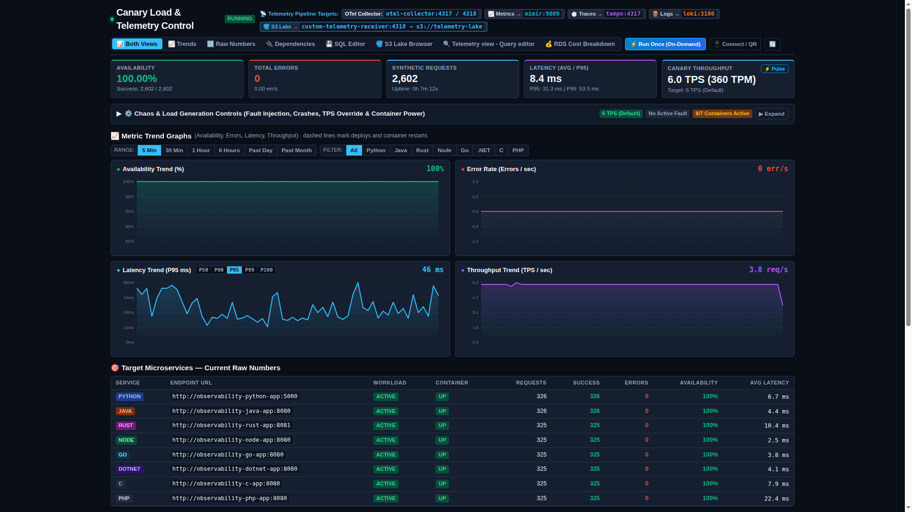
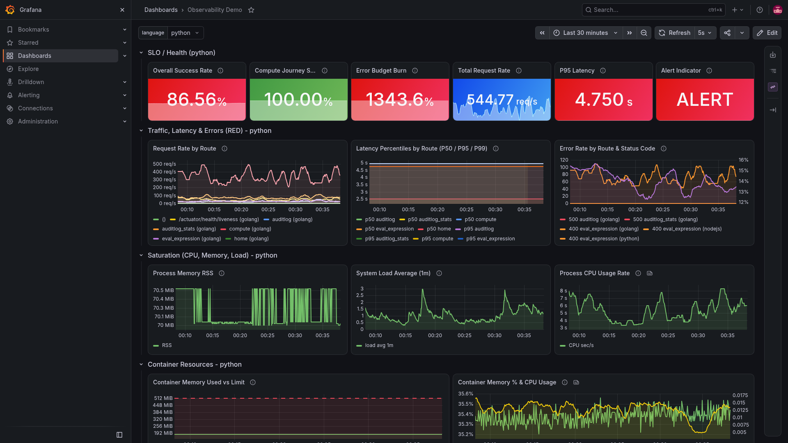

# Observability Demo

<div align="center">

[](https://purse-nebraska-transition-accessibility.trycloudflare.com)
[](https://kc25dgfws7f4oqbowcxhgpqwii0uyzxa.lambda-url.us-east-2.on.aws/)
[](https://github.com/sethusrinivasan/observability-demo/actions/workflows/live-verification.yml)
[](https://deepmind.google/technologies/)
[](https://deepmind.google/technologies/gemini/)

<br/>

[](https://www.python.org/)
[](https://spring.io/projects/spring-boot)
[](https://github.com/tokio-rs/axum)
[](https://nodejs.org/)
[](https://go.dev/)
[](https://dotnet.microsoft.com/)
[](https://en.wikipedia.org/wiki/C_(programming_language))
[](https://www.php.net/)
[](https://swift.org/)

<br/>

[](https://opentelemetry.io/)
[](https://grafana.com/)
[](https://www.docker.com/)

</div>

---

An end-to-end polyglot observability demo playground across **Python (Flask)**, **Java (Spring Boot)**, **Rust (Axum)**, **Node.js (Express)**, **Go (net/http)**, **C# .NET (ASP.NET Core)**, **C (POSIX C99)**, **PHP (CLI Server)**, and **Swift** microservices. Telemetry (traces, metrics, logs) is collected via OpenTelemetry Collector and exported to the **Grafana LGTM stack** (Loki, Grafana, Tempo, Mimir), alongside a PostgreSQL audit layer and an interactive synthetic **Canary Traffic & Fault Injection Dashboard**.

Deployable locally via **Docker Compose** or **Kubernetes (Kind)**, and to AWS via **Terraform-managed Graviton MicroVMs & S3 Telemetry Lake**.

---

## Architecture & Dashboards

### Canary Load & Telemetry Dashboard (`http://<HOST_IP>:8085`)
Interactive control center featuring real-time & historical trend graphs across 6 time ranges, language-color-coded fault injection testing, and dynamic load pacing.



### Grafana LGTM Observability Dashboard (`http://<HOST_IP>:3000`)
Consolidated distributed tracing (Tempo), metrics (Mimir/Prometheus), logs (Loki), and infrastructure health.



---

## Ultra-Frugal AWS Lambda MicroVM & Telemetry Lake Deployment

> [!WARNING]
> **AWS Cloud Usage & Cost Advisory**:
> Deploying this infrastructure provisions live AWS cloud resources (Amazon S3, AWS Lambda, Amazon ECR, EventBridge rules, and database connections). While engineered for extreme frugality, **running services in AWS incurs billable charges ($$) based on your account usage, existing infrastructure, and traffic volume**.
>
> **Important Note**: All cost estimates, tier calculations, and price breakdowns provided in this repository are **illustrative examples and benchmarks only**. Pricing varies by AWS region, transaction volume, database sizing, and individual billing tiers. **Anyone adopting, testing, or deploying this solution must independently evaluate their own infrastructure requirements, monitor their AWS Cost Explorer / billing console, and retest with their own traffic patterns to determine their exact numbers.**

The entire polyglot stack can be deployed to **AWS Lambda Firecracker MicroVMs** on **AWS Graviton (`arm64`)** with maximum frugality.

### Architectural Highlights
- **128 MB MicroVMs**: All 9 polyglot services and the custom collector run in 128 MB MicroVMs using the AWS Lambda Web Adapter (LWA), leveraging the permanent monthly Free Tier of **400,000 GB-seconds** (3.2 million compute seconds free every month).
- **Zero API Gateway Fees**: All ingress uses **Lambda Function URLs** with built-in HTTPS and CORS ($0.00).
- **Shared Aurora Serverless**: Reuses your existing Aurora Serverless cluster via bounded connection pools (1–2 per MicroVM) without incurring new baseline costs.
- **Custom S3 Parquet Lake**: Telemetry is buffered in `/tmp` and compacted into **>= 10 MB Snappy Parquet files** before uploading to S3, reducing S3 PUT API costs by **99.7%**.
- **DuckDB Serverless OLAP**: Runs in-process inside the Canary Lambda function, querying `s3://telemetry-lake/**/*.parquet` directly via IAM execution roles in 20–80 ms without Athena or Redshift fees.
- **Mandatory Resource Tagging**: All AWS resources created for this project are automatically tagged with `ApplicationName = "Observability-Demo"`.

### Live AWS Deployment Endpoints (us-east-2)

| Component | Architecture / Runtime | Public Function URL | Status |
|:---|:---|:---|:---:|
| **Canary Web Dashboard** | Lambda Web Adapter / Python 3.11 | [Canary Dashboard](https://kc25dgfws7f4oqbowcxhgpqwii0uyzxa.lambda-url.us-east-2.on.aws/) | `200 OK` (Green) |
| **Telemetry Collector & Lake** | LWA / Snappy Parquet Compactor | [OTLP Ingest](https://67lv2o2bb26q6thqvfcep2re3i0sjrom.lambda-url.us-east-2.on.aws/) | `200 OK` (Green) |
| **Python App** | 128 MB Graviton MicroVM / Flask | [Python App URL](https://2lwrbu2cc7bx7ay2ojapxsbqtq0andff.lambda-url.us-east-2.on.aws/version) | `200 OK` (Green) |
| **Java App** | 1024 MB Graviton MicroVM / Spring Boot | [Java App URL](https://2sqsnt447ofmtmjkdpoo36itlm0tifhq.lambda-url.us-east-2.on.aws/version) | `200 OK` (Green) |
| **Rust App** | 128 MB Graviton MicroVM / Axum | [Rust App URL](https://rq6puxwjoxx2sp5eeg3g4duy4i0bdjzs.lambda-url.us-east-2.on.aws/version) | `200 OK` (Green) |
| **Node.js App** | 128 MB Graviton MicroVM / Express | [Node App URL](https://7i7ewi4cvrpdzneou5qamrajsm0nwwkm.lambda-url.us-east-2.on.aws/version) | `200 OK` (Green) |
| **Go App** | 128 MB Graviton MicroVM / Go 1.25 | [Go App URL](https://vnh6kor267jkevye5uvvhcqfu40sffvo.lambda-url.us-east-2.on.aws/version) | `200 OK` (Green) |
| **.NET App** | 128 MB Graviton MicroVM / ASP.NET 8 | [.NET App URL](https://xppqo7vskzfjddbotn2mcaqgpe0wywzp.lambda-url.us-east-2.on.aws/version) | `200 OK` (Green) |
| **C App** | 128 MB Graviton MicroVM / POSIX C99 | [C App URL](https://daglnsziyvvlt572qmkzr2xmjm0unpef.lambda-url.us-east-2.on.aws/version) | `200 OK` (Green) |
| **PHP App** | 128 MB Graviton MicroVM / PHP 8.3 CLI | [PHP App URL](https://7izlc4ipjgw7uvgppjr7jiyymq0fxizg.lambda-url.us-east-2.on.aws/version) | `200 OK` (Green) |
| **Swift App** | 128 MB MicroVM / Swift | [Swift App URL](https://mk55snvnmmrerw22ptjwtusnly0rzuma.lambda-url.us-east-2.on.aws/version) | `200 OK` (Green) |

### Deploying to AWS via Terraform & Automation Scripts

The entire cloud architecture is codified in **Terraform** (`deployment/terraform/`) and orchestrated via the `./deploy_aws.sh` CLI wrapper.

#### Prerequisites
- **AWS CLI v2** configured with active credentials (`aws sts get-caller-identity`).
- **Terraform >= 1.5.0**.
- **Docker** with `buildx` support enabled for multi-platform (`linux/arm64`) image compilation.

#### Step-by-Step Deployment Guide

```bash
# Set your target AWS region (defaults to us-east-2)
export AWS_REGION="us-east-2"

# 1. Initialize Terraform providers and state
./deploy_aws.sh init

# 2. Review infrastructure execution plan
# (Enforces mandatory ApplicationName="Observability-Demo" resource tag)
./deploy_aws.sh plan

# 3. Provision S3 telemetry lake, ECR repositories, IAM roles, and Lambda URLs
./deploy_aws.sh apply

# 4. Build native Graviton arm64 container images and push to Amazon ECR
./deploy_aws.sh build-push all                       # Build and push all 10 containers
./deploy_aws.sh build-push observability-php-app    # Or build/push a single service

# 5. Update Lambda function code across all microservices
./deploy_aws.sh deploy all

# 6. View live HTTPS Function URLs and deployment outputs
./deploy_aws.sh status
```

#### Direct Terraform Commands

If you prefer operating Terraform directly without the wrapper script:

```bash
cd deployment/terraform

# 1. Initialize providers
terraform init

# 2. Plan deployment with custom Aurora DB host or default variables
terraform plan \
  -var="aws_region=us-east-2" \
  -var="aurora_db_host=your-aurora-cluster.rds.amazonaws.com"

# 3. Apply infrastructure
terraform apply \
  -var="aws_region=us-east-2" \
  -var="aurora_db_host=your-aurora-cluster.rds.amazonaws.com" \
  -auto-approve

# 4. View Function URLs
terraform output microservice_urls
terraform output canary_dashboard_url
```

#### Safe Infrastructure Teardown

To avoid incurring ongoing charges when testing is completed:

```bash
# Automated safe teardown (prompts for confirmation)
./deploy_aws.sh destroy

# Or direct Terraform teardown
cd deployment/terraform && terraform destroy -var="aws_region=us-east-2" -auto-approve
```

For complete architectural documentation, cost formulas, and runtime sizing tables, see:
- [`docs/aws_lambda_telemetry_lake_frugal_plan.md`](./docs/aws_lambda_telemetry_lake_frugal_plan.md)
- [`docs/frugal_lambda_telemetry_one_pager.md`](./docs/frugal_lambda_telemetry_one_pager.md)
- [`docs/frugal_lambda_telemetry_one_pager.md`](./docs/frugal_lambda_telemetry_one_pager.md)

---

## Features

* **Multi-Language Telemetry Parity**: Identical endpoint semantics, custom OTel histograms/counters, and tracing context across Python, Java, Rust, Node.js, Go, C# .NET, C (POSIX), PHP, and Swift.
* **Canary Load & Operations Station**:
  * **Collapsible Controls Drawer**: Chaos fault injection, target crashes, TPS overrides, and container power controls are enclosed in an expandable drawer that is **collapsed by default** to preserve screen real estate for clean monitoring.
  * **Container Power & Resource Management**: Shut down and restart individual containers hosting specific languages directly from the dashboard or mobile app to conserve system resources. Canary synthetic workload automatically detects container states and suspends requests to stopped containers, preventing artificial failure spikes.
  * **PostgreSQL SQL Query Editor & Data Grid**: First-principles interactive query runner inspired by SSMS, pgAdmin, and DataGrip. Features curated saved queries, query execution timing, and a responsive tabular data grid with `#` row numbering, sortable headers, and CSV/JSON export.
  * **Dependencies Health Telemetry**: Dedicated view rolling up availability %, roundtrip latency (ms), error rates, and resource capacity across all 9 stack dependencies (PostgreSQL, Valkey, OTel Collector, Tempo, Loki, Mimir, Prometheus, Grafana, Redpanda).
  * **Historical Trend Graphs**: Availability (%), Error Rate (err/s), Response Latency (ms), and Throughput (TPS) queried directly from Mimir across 6 horizons (`5m`, `30m`, `1h`, `6h`, `1d`, `30d`).
  * **Fault Injection Testing (Chaos Drills)**: Induce `Error Spikes`, `High Latency (+1000ms)`, `Service Outage (Drops)`, or `Intermittent Errors` with custom event tagging.
  * **Chaos Crash Triggering (Thread / Process Crash)**: Directly issue requests from the dashboard to target test environments to trigger process crashes or worker thread crashes with tagged events.
  * **Language-Specific Event Color Coding**: Fault events are visually tagged and overlaid on trend charts using distinct language color palettes (🟠 Java, 🔵 Python, 🟣 Rust, 🟢 Node, 🩵 Go, 💜 .NET, ⚙️ C, 🐘 PHP, 🕊️ Swift, 🔴 All).
  * **Dynamic Load Controller**: Bump up Canary TPS from baseline (6 TPS) to higher rates (e.g., 12, 24, 48 TPS) with automatic expiration and reset controls.
* **Cloudflare Tunnel Live Showcase Bridge (`scripts/showcase_tunnel.sh`)**: Zero-port-forwarding public HTTPS access engineered for hosting 24/7 live showcases on residential broadband connections from your internet service provider. Supports instant TryCloudflare quick tunnels (zero accounts or domains required) or permanent Cloudflare Zero Trust custom domains with automated TLS and DDoS protection. See [`docs/cloudflare-tunnel-showcase.md`](./docs/cloudflare-tunnel-showcase.md).
* **Cross-Platform React Native Mobile App (`mobile/`)**: Native companion client for Android, iOS, Windows, and Web. Includes an interactive SVG QR code in the Canary dashboard for instant mobile scanning and connection pairing.
* **Software Bill of Materials (SBOM)**: Comprehensive machine-readable CycloneDX 1.5 JSON artifact ([`sbom/sbom-cyclonedx.json`](./sbom/sbom-cyclonedx.json)) and detailed Markdown documentation ([`docs/sbom.md`](./docs/sbom.md)) acknowledging the implementation details and architectural inspirations for all polyglot microservices and stack components.
* **Distributed Tracing**: OTLP traces streamed from microservices through OpenTelemetry Collector into Grafana Tempo.
* **Metrics & Aggregations**: Standardized RED metrics (Rate, Errors, Duration) stored in Grafana Mimir.
* **Structured Logging**: Unified OTLP log pipeline shipping structured JSON logs to Grafana Loki.
* **PostgreSQL Audit Log**: Thread-safe connection pooling and automatic schema initialization recording audit events.
* **Mathematical Expression Evaluator**: Clean zero-dependency AST parser implementing the Shunting-Yard / recursive-descent algorithm across all nine languages.

---

## Quick Start

### 1. New Machine Setup & Prerequisites

If running on a fresh machine or setting up a new development environment, use the automated setup script to configure Docker, Python venv, test dependencies, and `.env`:

```bash
./setup.sh --check      # Diagnostic mode: view installed vs missing prerequisites
./setup.sh              # Standard local setup (Docker Engine, Python venv, cloudflared)
./setup.sh --full       # Full developer setup (+ kubectl, kind, terraform, aws-cli)
```

### 2. Local Docker Compose Stack

```bash
./launch_docker.sh --run               # Full teardown, build & deploy
./launch_docker.sh --run --keep-data   # Deploy while preserving database volumes
./launch_docker.sh --run --tunnel      # Deploy with live Cloudflare showcase tunnel
./scripts/showcase_tunnel.sh --quick   # Instant public HTTPS showcase link (zero config)
./launch_docker.sh --teardown-only     # Stop and clean up containers
# Or quick shortcuts:
./start.sh                             # Start containers in background
./test.sh                              # Run smoke & integration tests
./stop.sh                              # Stop containers preserving volumes
```

Once deployment completes, access the services:

> [!TIP]
> **Network Addressing**: Replace `<HOST_IP>` with your host machine's LAN IP address (e.g. `192.168.1.50`, or auto-discovered in the Canary QR code modal) for access across your local network and mobile devices. Use `localhost` if connecting locally on the same host.

| Component | URL | Credentials / Notes |
|-----------|-----|---------------------|
| **Canary Dashboard** | `http://<HOST_IP>:8085` | Trend graphs, fault injection & TPS controls |
| **Grafana** | `http://<HOST_IP>:3000` | `admin` / `admin` (Anonymous login disabled) |
| **Python App** | `http://<HOST_IP>:5000` | Flask + Gunicorn WSGI |
| **Java App** | `http://<HOST_IP>:8080` | Spring Boot 3 + Spring MVC |
| **Rust App** | `http://<HOST_IP>:8083` | Tokio + Axum async runtime (8081 on Kind) |
| **Node.js App** | `http://<HOST_IP>:8084` | Node.js 20 + Express (30007 on Kind) |
| **Go App** | `http://<HOST_IP>:8086` | Go 1.23 + net/http (30008 on Kind) |
| **.NET App** | `http://<HOST_IP>:8087` | C# .NET 8 + ASP.NET Core (30009 on Kind) |
| **C App** | `http://<HOST_IP>:8088` | POSIX C99 Sockets + libpq (30010 on Kind) |
| **PHP App** | `http://<HOST_IP>:8089` | PHP 8.3 CLI multi-worker server (30011 on Kind) |
| **Swift App** | `http://<HOST_IP>:8091` | Swift 6.0 Standard Library server (30012 on Kind) |
| **Prometheus** | `http://<HOST_IP>:9090` | Target scrapers & metrics |
| **Grafana Mimir** | `http://<HOST_IP>:9009` | Long-term PromQL metrics engine |
| **Grafana Tempo** | `http://<HOST_IP>:3200` | Distributed trace backend |
| **Grafana Loki** | `http://<HOST_IP>:3100` | Log aggregation engine |

### Live Showcase & Remote Access (Cloudflare Tunnel)

To access your stack remotely or share a live demo with anyone in the world without opening ports on your router or exposing your home network, the platform includes integrated **Cloudflare Tunnel (`cloudflared`)** support. This completely bypasses any inbound port restrictions or dynamic IP changes from your internet service provider through an encrypted outbound tunnel with automated TLS/HTTPS.

#### How to Use It Right Now

##### 1. Instant Public Showcase (Zero Configuration — No Account Required)
To spin up a live public HTTPS link in ~3 seconds with zero accounts and zero configuration:

```bash
./scripts/showcase_tunnel.sh --quick
```

This provisions an instant TryCloudflare HTTPS URL:
```text
=================================================================
 🎉 LIVE PUBLIC SHOWCASE URL READY!
=================================================================
  Public HTTPS URL:  https://your-random-subdomain.trycloudflare.com
  Target Service:    Canary Telemetry & Load Dashboard (port 8085)
```
* **World-Wide Access**: Share this URL with anyone on mobile, tablet, or desktop.
* **Auto-Discovery**: The Canary dashboard's QR code modal automatically detects this tunnel URL so mobile scans connect seamlessly over public HTTPS.
* **Check Status**: `./scripts/showcase_tunnel.sh --status`
* **Stop Tunnel**: `./scripts/showcase_tunnel.sh --stop`

##### 2. Permanent 24/7 Custom Domain Showcase (Cloudflare Zero Trust Free Tier)
For a permanent, branded showcase (e.g. `showcase.yourdomain.com` for Canary and `grafana.yourdomain.com` for Grafana):

1. **Obtain Free Tunnel Token**:
   * Navigate to the [Cloudflare Dashboard](https://dash.cloudflare.com/) -> **Zero Trust** -> **Networks** -> **Tunnels**.
   * Click **Create Tunnel** -> Choose **Cloudflared** -> Name your tunnel.
   * Under **Install and run a connector**, select **Docker** and copy the tunnel token.
2. **Configure Public Hostnames in Cloudflare**:
   * `showcase.yourdomain.com` -> Service: `HTTP`, URL: `canary:8085`
   * `grafana.yourdomain.com` -> Service: `HTTP`, URL: `grafana:3000`
3. **Launch the Tunnel**:
   ```bash
   # Option A: Direct launch with token
   ./scripts/showcase_tunnel.sh --token <YOUR_CLOUDFLARE_TUNNEL_TOKEN>

   # Option B: Persistent deployment via .env
   echo "CLOUDFLARE_TUNNEL_TOKEN=<YOUR_CLOUDFLARE_TUNNEL_TOKEN>" >> .env
   ./launch_docker.sh --run --keep-data --tunnel
   ```

For detailed architecture diagrams, 24/7 power outage recovery, and systemd autostart service templates, see [`docs/cloudflare-tunnel-showcase.md`](./docs/cloudflare-tunnel-showcase.md).

### Kubernetes (Kind)

```bash
./launch_k8s.sh --run              # Spin up Kind cluster, build images, and apply manifests
./launch_k8s.sh --teardown-only    # Delete Kind cluster
```

*Port-forwarding is established automatically by the launch script.*

---

## Project Structure

The repository is cleanly organized into root functional groups:

```text
observability-demo/
├── apps/                         # Polyglot microservices (9 runtimes + mobile)
│   ├── c/                        # POSIX C99 multi-threaded socket service
│   ├── dotnet/                   # C# .NET 8 ASP.NET Core service
│   ├── go/                       # Go 1.25 concurrent service
│   ├── java/                     # Java 21 / Spring Boot 3.2 service
│   ├── mobile/                   # React Native mobile client
│   ├── node/                     # Node.js 22 LTS Express service
│   ├── php/                      # PHP 8.3 CLI multi-worker service
│   ├── python/                   # Python 3.11 Flask service
│   ├── rust/                     # Rust 1.77 Axum asynchronous service
│   ├── swift/                    # Swift 6.0 Standard Library service
│   └── telemetry-receiver/       # Ephemeral disk buffering OTLP receiver
├── canary/                       # Synthetic traffic injector & DuckDB OLAP dashboard
├── config/                       # Grafana LGTM, OTel collector, and DB configurations
├── deployment/                   # Cloud & container deployment orchestration
│   ├── docker/                   # Supplementary compose manifests
│   ├── k8s/                      # Kubernetes manifests and Kind deployment scripts
│   ├── terraform/                # AWS Lambda MicroVM & S3 telemetry lake IaC
│   ├── deploy_aws.sh             # AWS deployment orchestration CLI
│   ├── deploy_demo.sh            # Live showcase deployment & verification bridge
│   ├── launch_docker.sh          # Full Docker teardown & fresh deployment engine
│   └── launch_k8s.sh             # Kind cluster creation & manifest deployer
├── docs/                         # Architecture guides, cost plans, and screenshots
├── sbom/                         # CycloneDX Software Bill of Materials
├── scripts/                      # Cloudflare showcase tunnel & automation helpers
├── tests/                        # Unit, smoke, UI guard, and Terraform IaC test suites
├── docker-compose.yaml           # Primary Docker Compose configuration
├── deploy_aws.sh                 # Root convenience wrapper -> deployment/deploy_aws.sh
├── launch_docker.sh              # Root convenience wrapper -> deployment/launch_docker.sh
├── launch_k8s.sh                 # Root convenience wrapper -> deployment/launch_k8s.sh
├── setup.sh                      # Workstation prerequisite setup & health checker
├── start.sh / stop.sh / test.sh  # Developer shortcuts for local run & smoke test
└── README.md                     # Documentation & live deployment showcase
```

---

## Stack Components

| Component | Port | Purpose | Version |
|---|---|---|---|
| [Python Service](./apps/python) | `5000` | Flask WSGI service, DB connection pool, Shunting-Yard evaluator | `1.0.1` |
| [Java Service](./apps/java) | `8080` | Spring Boot service, Spring Data JDBC, Actuator health probes | `1.0.1` |
| [Rust Service](./apps/rust) | `8083` (Docker) / `8081` (Kind) | Axum asynchronous service, SQLx Postgres pool, tokenizer evaluator | `1.0.1` |
| [Node.js Service](./apps/node) | `8084` (Docker) / `30007` (Kind) | Express asynchronous service, pg connection pool, recursive-descent evaluator | `1.0.1` |
| [Go Service](./apps/go) | `8086` (Docker) / `30008` (Kind) | Go net/http service, lib/pq connection pool, recursive-descent evaluator | `1.0.1` |
| [.NET Service](./apps/dotnet) | `8087` (Docker) / `30009` (Kind) | C# .NET 8 ASP.NET Core service, Npgsql connection pool, recursive-descent evaluator | `1.0.1` |
| [C Service](./apps/c) | `8088` (Docker) / `30010` (Kind) | POSIX C99 multi-threaded socket service, libpq, zero-dependency evaluator | `1.0.1` |
| [PHP Service](./apps/php) | `8089` (Docker) / `30011` (Kind) | PHP 8.3 CLI multi-worker server, PDO pgsql, recursive-descent evaluator | `1.0.1` |
| [Swift Service](./apps/swift) | `8091` (Docker) / `30012` (Kind) | Swift 6.0 standard library microservice, recursive-descent evaluator | `1.0.1` |
| [Canary Dashboard](./canary) | `8085` | Synthetic traffic generator, historical trend graphs, chaos fault injection | `1.0.1` |
| [Canary Mobile App](./apps/mobile) | — | Cross-platform React Native client for Android, iOS, Windows, Web | `1.0.0` |
| [CycloneDX SBOM](./sbom/sbom-cyclonedx.json) | — | Software Bill of Materials & architectural acknowledgments | `1.5` |
| Grafana | `3000` | Provisioned dashboards and data source integration (`admin`/`admin`) | `13.2.2` |
| Grafana Image Renderer | `8081` | Headless Chromium sidecar for automated PNG panel rendering | pinned digest |
| Prometheus | `9090` | Exporter scraper and metrics buffer | `3.15.0` |
| Grafana Mimir | `9009` | Distributed long-term metrics storage | `3.2.1` |
| Grafana Tempo | `3200` | High-scale distributed tracing backend with OTLP ingestion | `3.0.0` |
| Grafana Loki | `3100` | Log aggregation backend | `3.7.8` |
| OTel Collector | `4317` (gRPC) / `4318` (HTTP) | Telemetry ingestion and routing pipeline | `0.161.0` |
| PostgreSQL | `5432` | Audit log database with persistence | `18.6` |
| Postgres Exporter | `9187` | Database runtime metrics (connections, locks, buffers) | `0.16.0` |
| Valkey | `6379` | High-performance Redis fork for canary counters and event logs | `9.1.2` |
| Redis Exporter | `9121` | Prometheus scraper for Valkey cache telemetry | `1.92.1` |
| Redpanda | `9092` | Kafka-compatible distributed event streaming platform | `26.2.3` |

---

## API Endpoints Matrix

Every microservice implements identical API contracts:

| Route | Method | Description | Sample Query |
|---|---|---|---|
| `/` | `GET` | Service index & environment info | `curl http://<HOST_IP>:5000/` |
| `/version` | `GET` | Service metadata, language, and version | `curl http://<HOST_IP>:8080/version` |
| `/selftest` | `GET` | In-process internal unit verification | `curl http://<HOST_IP>:8083/selftest` |
| `/compute/<n>` | `GET` | Fibonacci calculation (rejects `n > 25`) | `curl http://<HOST_IP>:5000/compute/10` |
| `/auditlog` | `GET`, `POST` | Insert/query persistent audit log record | `curl -X POST http://<HOST_IP>:8080/auditlog -d "source=cli"` |
| `/auditlog/stats` | `GET` | Aggregated audit log row statistics | `curl http://<HOST_IP>:8083/auditlog/stats` |
| `/eval?expr=...` | `GET`, `POST` | Custom zero-eval arithmetic expression parser | `curl "http://<HOST_IP>:5000/eval?expr=2%2B3*4"` |
| `/crash` | `GET`, `POST` | Chaos testing: triggers process or thread crash (`?type=process` or `?type=thread`) | `curl -X POST "http://<HOST_IP>:8080/crash?type=thread"` |

*Note: For the `/eval` endpoint, operators like `+` must be URL-encoded (`%2B`).*

---

## Testing & Verification

Comprehensive multi-layer test suite covering unit tests, evaluator logic, infrastructure health, and end-to-end integration:

```bash
pip install -r requirements-dev.txt

# Multi-language integration smoke tests
python3 tests/smoke_test.py --docker

# Run unit and infrastructure test suite
pytest tests/ -v
```

`pytest` lives in `requirements-dev.txt`, so it is not installed in the Python service image.

Stop the stack and keep volumes with `./stop.sh`. `./launch_docker.sh --teardown-only` also deletes volumes.

If the Docker daemon restarts and containers lose bridge connectivity, bring the stack back with `docker compose up -d`. Compose recreates the bridge rules. Do not kill container processes on the host.

---

## AI Tooling & Attribution

This project was developed, debugged, and enhanced with the assistance of modern agentic AI systems:

* **[Google Antigravity](https://deepmind.google/technologies/)**: Autonomous engineering pair programmer used for end-to-end telemetry architecture, root-cause diagnosis of microservice anomalies, chaos engineering design, and full-stack dashboard implementation.
* **[Gemini CLI](https://deepmind.google/technologies/gemini/)**: Advanced agentic coding workflows for polyglot code synchronization across Python, Java, Rust, Node.js, Go, C# .NET, C, PHP, and Swift, PromQL query optimization, and test automation.

---

## License

This project is licensed under the Apache License 2.0.
