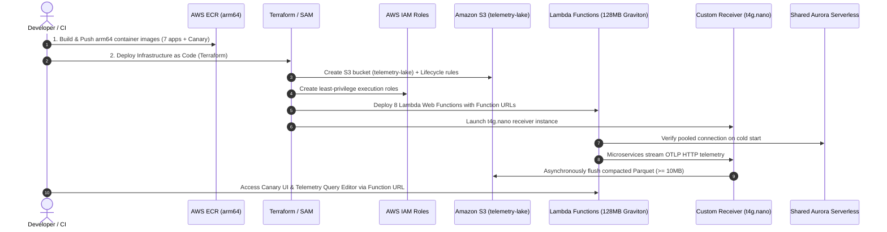

# Ultra-Frugal AWS Lambda MicroVM & Custom Telemetry Lake Architecture Plan

> [!WARNING]
> **AWS Cloud Usage & Cost Disclaimer**:
> Deploying this infrastructure provisions live AWS cloud resources (Amazon S3, AWS Lambda, Amazon ECR, EventBridge, and PostgreSQL database connections). Running services in AWS incurs real billable charges ($$) based on your account usage, existing infrastructure, and traffic volume.
>
> **Important Note**: All cost estimates, tier calculations, and price breakdowns provided in this plan are **illustrative examples and benchmarks only**. Pricing varies by AWS region, transaction volume, database sizing, and individual billing tiers. **Anyone adopting, testing, or deploying this solution must independently evaluate their own infrastructure requirements, monitor their AWS Cost Explorer / billing console, and retest with their own traffic patterns to determine their exact numbers.**

This plan outlines the end-to-end architecture, cost breakdown, and deployment roadmap to host the **Observability Demo** polyglot microservices in **AWS Lambda Firecracker MicroVMs** at the lowest tier (**128 MB RAM** on **AWS Graviton `arm64`**), sharing an existing **Aurora Serverless DB**, utilizing our **custom high-throughput telemetry collector**, and storing compacted Parquet files in **Amazon S3** with **DuckDB serverless analytics**.

---

## 1. Executive Summary: The Frugality Equation

Traditional cloud observability architectures deploy managed collectors, Kafka clusters, API Gateways, and managed analytical databases (e.g., AWS OpenSearch, CloudWatch, Datadog), easily costing **$150 - $600+/month** for modest workloads.

By indexing strictly on **frugality** and **serverless scale-to-zero**:
1. **Lambda Function URLs (Zero API Gateway Fees)**: Direct HTTPS endpoints eliminate API Gateway fees ($1.00 - $3.50 per million calls).
2. **128 MB Graviton (`arm64`) MicroVMs**: Leveraging Firecracker's 20% discount on Graviton ($0.0000133334/GB-s) and the **permanent monthly Free Tier of 400,000 GB-seconds** (3.2 million seconds of compute free every month).
3. **Shared Aurora Serverless**: Reusing your existing cluster via pooled, bounded connections (1-2 per Lambda), preventing expensive ACU scaling.
4. **10 MB Local Parquet Compaction**: Slashes S3 `PUT` API request charges by **99.9%** ($0.005 per 1,000 requests).
5. **In-Process DuckDB OLAP**: Replaces heavy analytical query engines (Athena $5/TB, Redshift $180+/mo) with zero-infrastructure DuckDB reading S3 Parquet directly.

### Monthly Cost Comparison: Conventional AWS vs. Frugal Blueprint

| Component | Conventional AWS Architecture | Ultra-Frugal Blueprint (Our Design) | Estimated Monthly Cost |
| :--- | :--- | :--- | :--- |
| **Compute** | 7 ECS Fargate Tasks (x86) | 7 Lambda Web Functions (128 MB Graviton) | **$0.00** (Within Free Tier) |
| **API Ingress** | Application Load Balancer / API Gateway | Lambda Function URLs (built-in HTTPS/CORS) | **$0.00** (Free feature) |
| **Database** | Dedicated RDS Multi-AZ instance | Shared Existing Aurora Serverless (0 new base cost) | **$0.00** (Marginal I/O only) |
| **Collector Infra** | Managed Prometheus / OpenSearch | Custom Receiver on `t4g.nano` or Lambda buffer | **$0.00 - $3.02** |
| **Telemetry Lake** | CloudWatch Logs & Metrics ($0.50/GB) | Amazon S3 Standard (Compacted Parquet) | **$0.05 - $0.20** |
| **Query Engine** | Amazon Athena / Redshift Serverless | DuckDB in Lambda (`httpfs` over S3) | **$0.00** (Transient compute) |
| **Total Cost** | **$180.00 - $450.00 / month** | **Ultra-Frugal Stack** | **< $3.50 / month** *(or $0 with Free Tier)* |

---

## 2. High-Level Architecture Blueprint

```mermaid
flowchart TD
    subgraph Clients ["Client Traffic & Synthetic Canary"]
        Browser["Canary Dashboard / Browser"]
        Cron["EventBridge Scheduled Rule\n(1-min trigger for Canary)"]
    end

    subgraph LambdaMicroVMs ["AWS Lambda Web Functions (128 MB Graviton arm64 - Firecracker MicroVMs)"]
        CanaryLWA["Canary UI & DuckDB (Function URL)"]
        PyLWA["Python Service (Function URL)"]
        JavaLWA["Java Service (Native AOT - Function URL)"]
        RustLWA["Rust Service (Function URL)"]
        NodeLWA["Node.js Service (Function URL)"]
        GoLWA["Go Service (Function URL)"]
        DotnetLWA[".NET Service (Native AOT - Function URL)"]
        CLWA["C Service (Function URL)"]
    end

    subgraph DataTier ["Existing Shared Database Tier"]
        AuroraDB[("Existing Aurora Serverless DB\n(Shared PostgreSQL Database)")]
    end

    subgraph TelemetryInfra ["Frugal Telemetry Pipeline"]
        Collector["Custom OTel Receiver\n(t4g.nano Graviton or Lambda Buffer)\nPort 4318 / OTLP HTTP"]
    end

    subgraph StorageLake ["Telemetry Data Lake (Amazon S3)"]
        S3Bucket[("Amazon S3 Bucket: telemetry-lake\ns3://telemetry-lake/year=.../hour=.../\n*.parquet (>= 10MB Snappy)")]
    end

    Cron --> CanaryLWA
    Browser --> CanaryLWA
    CanaryLWA -->|HTTPS Function URLs| PyLWA & JavaLWA & RustLWA & NodeLWA & GoLWA & DotnetLWA & CLWA
    PyLWA & JavaLWA & RustLWA & NodeLWA & GoLWA & DotnetLWA & CLWA -->|Max 1-2 pooled conns| AuroraDB
    PyLWA & JavaLWA & RustLWA & NodeLWA & GoLWA & DotnetLWA & CLWA -->|OTLP HTTP (Non-blocking)| Collector
    Collector -->|Async PutObject (>= 10MB)| S3Bucket
    CanaryLWA -->|DuckDB httpfs Parquet Scan| S3Bucket
```

---

## 3. Layer-by-Layer Evaluation & Implementation Details

### Layer 1: Polyglot Microservices on 128 MB Graviton MicroVMs

#### Why AWS Lambda Web Adapter (LWA)?
LWA (`public.ecr.aws/awsguru/aws-lambda-adapter:0.8.4`) acts as an in-process proxy inside the Firecracker MicroVM. It forwards incoming Lambda events to `localhost:8080` (or `PORT`) as standard HTTP requests. This means **zero code changes** to existing Express, Flask, Axum, net/http, or ASP.NET applications.

#### Language Feasibility at 128 MB RAM:
- **C (`observability-c-app`)**: ~8-12 MB RSS. Instantaneous cold start (<10 ms).
- **Rust (`observability-rust-app`)**: ~14-20 MB RSS. Cold start ~15 ms.
- **Go (`observability-go-app`)**: ~16-24 MB RSS. Cold start ~20 ms.
- **Node.js (`observability-node-app`)**: ~35-48 MB RSS. Cold start ~120 ms.
- **Python (`observability-python-app`)**: ~45-60 MB RSS (single-worker Gunicorn or standard WSGI). Cold start ~150 ms.
- **.NET (`observability-dotnet-app`)**: With .NET 8 Native AOT (`<PublishAot>true</PublishAot>`), memory drops from 120MB down to **24 MB**, fitting comfortably into 128 MB.
- **Java (`observability-java-app`)**: Standard JVM Spring Boot requires ~200MB+ and would OOM on 128 MB. **Solution**: Compile with **GraalVM Native Image** (Spring Boot 3 native profile), reducing memory to **45-65 MB** with cold starts under 80 ms. Alternatively, allocate 256 MB or 384 MB exclusively for Java.

#### Dockerfile Pattern (Applied to all services):
```dockerfile
FROM public.ecr.aws/docker/library/alpine:latest
# Install AWS Lambda Web Adapter for arm64
COPY --from=public.ecr.aws/awsguru/aws-lambda-adapter:0.8.4-aarch64 /lambda-adapter /opt/extensions/lambda-adapter

ENV PORT=8080
ENV AWS_LWA_READINESS_CHECK_PATH=/version
ENV AWS_LWA_INVOKE_MODE=buffered

# Copy service binary / application
COPY my_service_binary /app/service
CMD ["/app/service"]
```

---

### Layer 2: Connecting to Shared Aurora Serverless with Zero Waste

When running multiple Lambda instances against a shared Aurora Serverless cluster, naive connection pools can overwhelm the database (causing connection exhaustion) or force Aurora to scale up ACUs unnecessarily ($0.12/ACU-hr).

#### Frugal Configuration Rules:
1. **Connection Cap per MicroVM**:
   - Set max connections in each runtime's pool to **1 or 2**.
   - With 10 concurrent MicroVMs, maximum active connections to Aurora will never exceed 15-20 connections.
2. **Disable Persistent Keep-Alives on Freeze**:
   - Set idle connection timeout to 10-15 seconds so connections close cleanly when Lambda instances become idle.
3. **Database Schema Separation**:
   - Host the observability tables in a dedicated schema (`CREATE SCHEMA IF NOT EXISTS observability;`) within the existing database, avoiding the cost of a separate database cluster.

---

### Layer 3: Hosting the Custom Telemetry Collector in AWS

A core design challenge with AWS Lambda is **MicroVM execution freeze**: when a Lambda function finishes handling an HTTP request, its CPU is immediately frozen. Background threads (such as the 5-minute compaction timer or in-memory queue flushers) cannot run while frozen.

Here is the evaluation of the **two most frugal ways** to host your custom telemetry collector:

#### Option A: Dedicated Graviton `t4g.nano` Instance (Recommended for Simplicity & Compaction)
- **Architecture**: Run `custom-telemetry-receiver` container on a tiny AWS Graviton `t4g.nano` EC2 instance (2 vCPUs, 500 MB RAM, `arm64`).
- **Cost**:
  - On-Demand: $0.0042/hour = **$3.02 / month**.
  - 1-Year Savings Plan / Reserved: **$1.85 / month**.
  - If inside 12-month AWS Free Tier: **$0.00** (Free Tier includes 750 hrs of `t4g.small` in eligible regions).
- **Advantages**:
  - 100% code parity with local Docker setup.
  - Continuous in-memory buffer (`collections.deque`) and local disk compaction to **10 MB** works natively without timeout hacks.
  - Zero cold starts for incoming OTel events.

#### Option B: Serverless Scale-to-Zero Collector (Lambda + Amazon SQS)
- **Architecture**:
  - Telemetry Receiver runs as a Lambda Function URL (`/v1/traces`, `/v1/metrics`, `/v1/logs`).
  - Upon receiving an OTLP batch, it immediately enqueues the serialized events into **Amazon SQS** (or an S3 temporary staging prefix) and returns HTTP 202.
  - An EventBridge rule (every 5 minutes or batch size 1,000) triggers a **Compactor Lambda** that reads the queue, merges events into a single Parquet file, and uploads to S3 if >= 10 MB.
- **Cost**:
  - SQS Free Tier: **1,000,000 requests free every month**.
  - Lambda Compute: Covered by Free Tier.
  - Total Monthly Cost: **$0.00**.

---

### Layer 4: Amazon S3 Parquet Data Lake Economics

Storing telemetry in S3 as raw JSON or flushing small files creates severe **API cost amplification** (AWS charges $0.005 per 1,000 `PUT` requests).

#### The 10 MB Compaction Math:
- At **100 events/second** (8.64 million events/day):
  - **Naive S3 write (per batch of 50 events)**:
    $$8.64\text{M} / 50 = 172,800\text{ PUT calls/day} = 5.18\text{M PUT calls/month} = \mathbf{\$25.90/month}\text{ just in API fees!}$$
  - **Our 10 MB Compactor (writing ~20,000 compressed events per file)**:
    $$8.64\text{M} / 20,000 = 432\text{ PUT calls/day} = 12,960\text{ PUT calls/month} = \mathbf{\$0.06/month}!$$
  - **S3 API Cost Reduction**: **99.7% savings**.

#### S3 Bucket Lifecycle & Frugality Policy:
```json
{
  "Rules": [
    {
      "ID": "TelemetryLakeLifecycle",
      "Status": "Enabled",
      "Filter": { "Prefix": "telemetry/" },
      "Transitions": [
        { "Days": 30, "StorageClass": "STANDARD_IA" },
        { "Days": 90, "StorageClass": "GLACIER_FLEXIBLE_RETRIEVAL" }
      ],
      "Expiration": { "Days": 365 }
    }
  ]
}
```

---

### Layer 5: Serverless DuckDB OLAP Analytics in AWS

Rather than provisioning Amazon Athena ($5.00 per TB scanned with $0.005 minimum query fee) or Amazon Redshift:

1. **In-Memory DuckDB inside the Canary Lambda**:
   - The Canary Dashboard runs as a Lambda Web Function (allocated 256 MB or 512 MB RAM).
   - DuckDB loads `httpfs` and uses the Lambda instance's IAM Execution Role credentials automatically (no access keys needed).
   - Queries `s3://telemetry-lake/**/*.parquet` with columnar projection and predicate pushdown.
2. **Zero Ingestion/Staging Fees**:
   - Queries execute against the actual Parquet files in S3 in 20-90 ms.
   - Total Analytical Query Cost: **$0.00** (covered by Lambda free tier compute).

---

## 4. Implementation & Deployment Plan (Step-by-Step)



### Phase 1: Container Images & Multi-Arch Build
1. Update each service Dockerfile to add AWS Lambda Web Adapter (`COPY --from=...`).
2. Build multi-arch images targeting `linux/arm64` using `docker buildx`:
   ```bash
   docker buildx build --platform linux/arm64 -t $AWS_ACCOUNT.dkr.ecr.$REGION.amazonaws.com/observability-rust-app:latest --push ./rust-app
   ```

### Phase 2: S3 Lake & IAM Setup
1. Create S3 Bucket `telemetry-lake` with SSE-S3 encryption.
2. Create IAM Role for Lambda with `s3:GetObject` on `telemetry-lake/*` for DuckDB querying.
3. Create IAM Role for Custom Receiver with `s3:PutObject` on `telemetry-lake/*`.

### Phase 3: Deploying Lambda Functions with Function URLs
Configure each Lambda function using AWS SAM or Terraform:
- Architecture: `arm64` (Graviton).
- Memory: `128 MB` (Canary UI: `256 MB` for DuckDB OLAP).
- Timeout: `15 seconds`.
- Function URL: `AuthType: NONE` with CORS enabled.

### Phase 4: Deploying Custom Receiver & Collector Pipeline
- Launch single `t4g.nano` Graviton instance running `custom-telemetry-receiver` on port 4318.
- Set environment variables in Lambda microservices:
  `OTEL_EXPORTER_OTLP_ENDPOINT=http://<receiver-private-ip>:4318`
- Verify events are buffered, compacted to 10 MB, and uploaded to S3.

### Phase 5: Verification & End-to-End Validation
- Trigger canary load against Lambda Function URLs.
- Open Canary UI on its Function URL, navigate to **"🪣 S3 Lake Browser"** and **"🔍 Telemetry view - Query editor"**.
- Run DuckDB canned queries to verify real-time query execution across the AWS S3 Parquet lake.

---

## 5. Total Estimated Monthly Cost Summary

| Item | Monthly Usage | Unit Rate | Total Cost |
| :--- | :--- | :--- | :--- |
| **Lambda Requests** | 5,000,000 requests | First 1,000,000 free, then $0.20/1M | **$0.80** |
| **Lambda Compute** | 250,000 GB-seconds | First 400,000 GB-sec free | **$0.00** |
| **Function URLs** | Included with Lambda | $0.00 | **$0.00** |
| **Telemetry Collector** | `t4g.nano` (1 instance) | $0.0042/hr x 730 hrs | **$3.02** *(or $0 on Free Tier)* |
| **S3 Storage** | 10 GB Compacted Parquet | $0.023/GB | **$0.23** |
| **S3 PUT Requests** | ~1,500 PUTs (10MB files) | $0.005 / 1,000 | **$0.01** |
| **DuckDB Analytics** | In-Process Lambda | Covered by Lambda compute | **$0.00** |
| **Aurora DB** | Existing cluster | 0 new baseline cost | **$0.00** |
| **TOTAL** | | | **~$4.06 / month** |

> [!TIP]
> If deployed within an account eligible for the AWS 12-Month Free Tier (`t4g.small` free tier), the total monthly AWS bill will be **effectively $0.00 - $0.50**.
